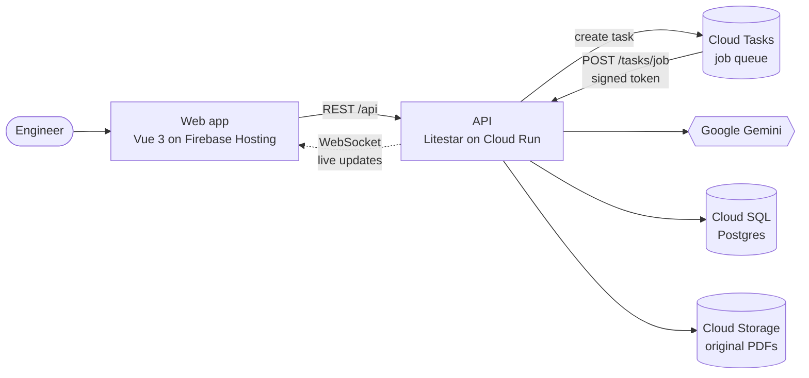
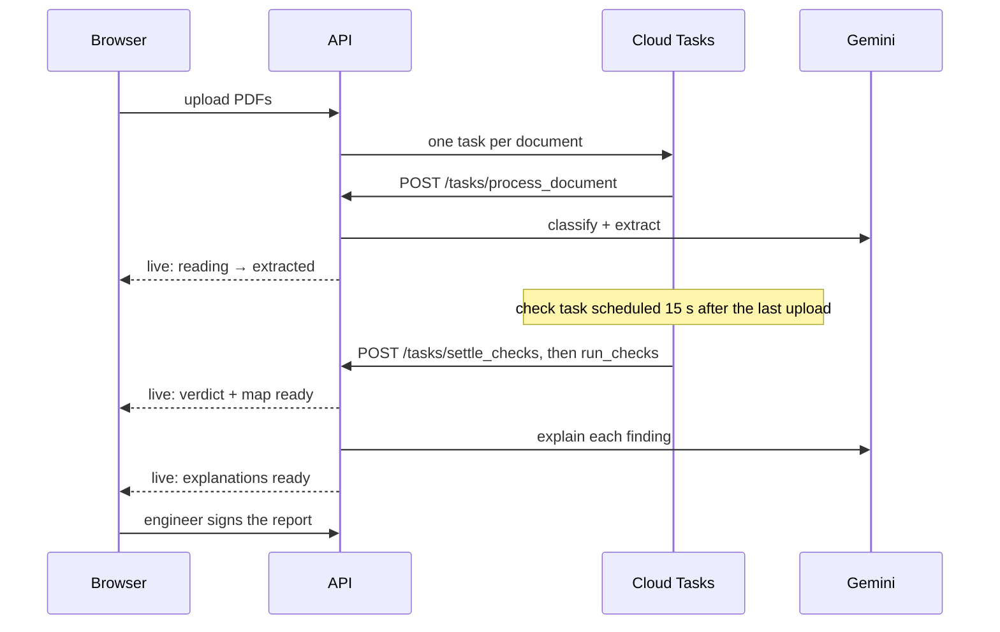

# Hibanako

**AI-powered quality documentation and traceability for manufacturing.**
*From scattered documents to confident quality decisions.*

Hibanako reads a welded-fabrication dossier with Google Gemini, links every material certificate,
weld, procedure and inspection into one traceability graph, and checks it against release rules.
The result is a clear verdict — **PASS**, **HOLD** or **REJECT** — with a ranked list of exceptions,
the evidence behind each one, and a report an engineer can sign.

> *Hibanako* comes from *hibana*, spark.

---

## 1. Introduction

### The problem

Manufacturing quality records — material certificates, welding records, inspection results and
production documents — live in separate files and formats. Before a product can ship, a quality
engineer has to reconcile them by hand: does every plate have a certificate with the right heat
number, is every weld tied to a qualified welder and procedure, does every weld have its NDT report?

Manual reconciliation is slow and error-prone, which leads to:

| | |
| --- | --- |
| **Delays in product release** | Shipments wait while engineers cross-check hundreds of pages |
| **Missing or inconsistent evidence** | One swapped digit in a heat number can slip through |
| **High administrative workload** | Skilled engineers spend hours on paperwork instead of quality |
| **Rework and quality costs** | Gaps found late mean re-inspection, rework or rejected shipments |

### Objective

Build an AI-assisted system that **prioritises and verifies the most critical documentation
checks** using the Pareto principle, making quality assurance faster and more reliable.

## 2. Why we need it

| | |
| --- | --- |
| **83%** | of engineers spend at least **4 hours per week** on procurement and supplier-related tasks, including supplier-quality management *(Fictiv Manufacturing Survey, 2026)* |
| **52%** | of manufacturing leaders name supplier quality, reliability and compliance as significant challenges *(Fictiv Manufacturing Survey, 2025)* |
| **33%** | of surveyed manufacturers have invested in unified data platforms with integration and analytical capabilities *(Dun & Bradstreet Manufacturing Pulse Survey, 2025)* |

**Result:** documentation gaps remain a common and costly problem in manufacturing.

## 3. Pareto analysis

We ranked manufacturing quality problems by demand (30%), impact (25%), feasibility (20%),
GenAI fit (15%) and differentiation (10%):

| Rank | Problem | Score |
| --- | --- | --- |
| **1** | **Quality-document reconciliation and traceability** | **92** |
| 2 | Supplier sourcing and order follow-up administration | 87 |
| 3 | Nonconformance and corrective-action management | 85 |
| 4 | Maintenance work-order triage and handover | 82 |
| 5 | Calibration and inspection due-date tracking | 80 |
| 6 | Scrap and rework analysis | 78 |

Hibanako focuses on the highest-value problem: **document reconciliation and traceability**.

## 4. Methods

### Workflow

| Step | What happens |
| --- | --- |
| **1. Document upload** | Upload material certificates, welding records, inspection reports and production documents — in bulk, in any order |
| **2. AI data extraction** | Gemini classifies each document and extracts the key fields (heat numbers, part numbers, weld IDs, WPS, welders, NDT results, signatures) as structured data, linked to the source page |
| **3. Traceability mapping** | Materials, parts, welds, procedures, welders and inspections are connected into one traceability graph |
| **4. Deterministic checks** | Rule-based checks test completeness, consistency and procedure compliance |
| **5. GenAI explanation** | Gemini explains each finding in plain language, points at the evidence and suggests the next step |
| **6. Release report** | A ranked exception list with supporting evidence, signed by the engineer |

### AI reads, rules decide

Gemini does the work that needs language understanding: reading messy, scanned documents and
explaining results. **The verdict never comes from the model.** PASS / HOLD / REJECT is decided by
plain, testable code over the extracted data, so the same dossier always gets the same verdict and
every finding traces back to the page it came from.

### Documents it reads

| Category | Examples |
| --- | --- |
| **Material** | Mill test certificates (EN 10204 3.1 / 3.2), material registers |
| **Welding** | Weld logs, WPS / PQR, welder qualification records |
| **NDT** | RT, UT, MT, PT and VT reports, NDT registers |
| **Inspection** | Inspection and test plans, drawings, dimensional and hydrotest reports |
| **Production** | Travelers, fit-up records, PWHT records, dossier index |

### System architecture



| Part | Role |
| --- | --- |
| **Web app** | Google sign-in, projects, workspace (documents, trace map, inspector) and printable report |
| **API** | Auth, projects, uploads, signed download links, check runs, sign-off, live events, and the background jobs themselves |
| **Cloud Tasks** | Durable job queue: calls the API back to read each document and run checks, retries on failure, delays the check run until uploads settle |
| **Cloud SQL** | Users, projects, extracted data, trace map, findings, sign-offs, AI usage log |
| **Cloud Storage** | Original files, private; opened through short-lived signed links |
| **Gemini** | Classification, structured extraction, finding explanations |

Locally there is no Cloud Tasks: with `HIBANAKO_TASKS_INLINE=true` the API runs the same jobs in-process,
four at a time, so only Postgres is needed.



- **One run per batch.** Uploading ten files triggers one check run, not ten.
- **Safe retries.** Cloud Tasks may deliver a job twice; a document already read or a run already finished is skipped. A document that takes more than 2 minutes fails with a message instead of hanging.
- **Verdict first, explanations second.** The map and verdict appear as soon as the rules finish.
- **Signature integrity.** A signature records exactly which documents it covered. If any document
  changes afterwards, the signature is marked **outdated** and the project needs re-signing.
- **Private by owner.** Users only see their own projects; every Gemini call is logged with model
  and token counts.

## 5. Pareto-based scope

The prototype focuses on the **critical few (20%) checks that carry most (80%) of the impact**:

| # | Check | Question | Flags |
| --- | --- | --- | --- |
| **1** | **Material traceability** | Is the material certificate matched with the correct part and register? | Missing heat number or certificate (HOLD); heat number conflict (REJECT) |
| **2** | **Welding-record linkage** | Is each weld linked to the required welding records and procedure? | WPS missing or not in the dossier; welder missing or unqualified; weld not on the traveler (HOLD) |
| **3** | **NDT evidence** | Does every required weld have inspection results? | Required report missing (HOLD); report rejects the weld (REJECT) |
| **4** | **Dossier completeness** | Are mandatory records missing, contradictory or awaiting sign-off? | PWHT required but not recorded; NDT report unsigned (HOLD) |

Any REJECT makes the project REJECT; otherwise any HOLD makes it HOLD; otherwise it passes and is
released once an engineer signs the report.

## 6. Results

Tested on synthetic dossiers in [`example-docs/`](example-docs/README.md), read by Gemini as-is
with no hand corrections:

| Dossier | Expected | Hibanako |
| --- | --- | --- |
| Clean, complete dossier | PASS | **PASS** — all four checks pass |
| Supplier first issue with 12 planted defects | REJECT | **REJECT** — caught all 6 defects in scope of the four checks, **0 false alarms** on 5 deliberate look-alikes (e.g. `H-48213` vs `48213`, `W01` vs `W-01`) |

Example output for the defective dossier:

| Status | Check | Finding |
| --- | --- | --- |
| REJECT | Material traceability | Heat number conflict for part P1: 48213 (certificate) vs 48231 (fabrication record) |
| REJECT | NDT evidence | RT-2233 rejects weld W-04 |
| HOLD | NDT evidence | No RT report references weld W-03 |
| HOLD | Welding-record linkage | W-03 references WPS-08, which is not in the dossier |
| HOLD | Dossier completeness | WPS requires PWHT for W-04; no PWHT record found |
The other 6 planted defects (expired welder qualification, welding current outside the WPS,
drawing revision mismatch, unsigned certificate, missing hydrotest, tensile below minimum) need
new rules, not better reading — they are the next step.

### Try it

The demo button on the login page opens three ready-made projects:

| Project | Verdict | Story |
| --- | --- | --- |
| HBK-DEMO-001 | **PASS** | Complete dossier, signed and released |
| HBK-DEMO-002 | **HOLD** | RT report for W-03 and a welder qualification missing; attach them and the welds turn PASS |
| HBK-DEMO-003 | **REJECT** | Supplier first issue with planted defects |

## 7. Discussion and impact

| | |
| --- | --- |
| **Reduces repetitive administrative work** | Engineers review a short, ranked exception list instead of every page |
| **Improves quality reliability** | Gaps and inconsistencies are caught early, with the same result every time |
| **Supports faster product release** | Clear, evidence-based exceptions with next steps; release is one signature away |
| **Scalable and practical** | A feasible starting point for digital quality assurance in small and medium manufacturers |

**Next:** the six additional rules above, engineer actions (correct a value, mark not applicable,
replace a file), an audit history, and an accuracy evaluation across repeated runs.

---

## Tech stack

| Layer | Technology |
| --- | --- |
| Frontend | Vue 3, Vite, Tailwind CSS v4, Vuex, Vue Router |
| Backend | Python 3.12, Litestar, SQLAlchemy (async), Alembic, Pydantic |
| AI | Google Gemini (`google-genai`, structured outputs) |
| Data | Cloud SQL (PostgreSQL), Google Cloud Storage |
| Jobs | Google Cloud Tasks (in-process locally) |
| Auth | JWT, Google Identity Services |
| Hosting | Docker, Firebase Hosting, Cloud Run |

## Repository

| Folder | What it is |
| --- | --- |
| [`backend/`](backend/README.md) | API, background jobs, AI extraction, rules, models, migrations, tests |
| [`frontend/`](frontend/README.md) | Web app |
| [`example-docs/`](example-docs/README.md) | Synthetic sample dossiers with their answer keys |
| `docker-compose.yml` | Whole stack in Docker |
| `firebase.json` | Firebase Hosting config for the frontend |

## Run it

```bash
cp .env.example .env
cp backend/.env.example backend/.env      # set GEMINI_API_KEY, HIBANAKO_JWT_SECRET, bucket
docker compose up -d --build
docker compose exec api python -m app.demo
```

Open http://localhost:8080. For development without Docker, see the
[backend](backend/README.md) and [frontend](frontend/README.md) READMEs.

---

Built with Google Gemini · Deployed on Google Cloud
